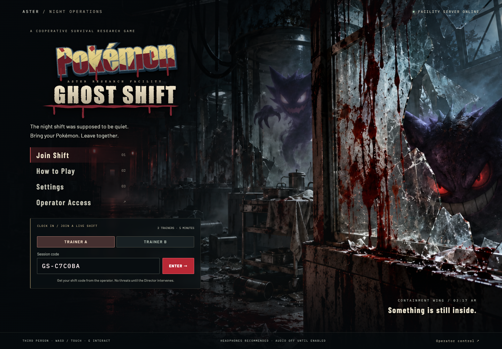
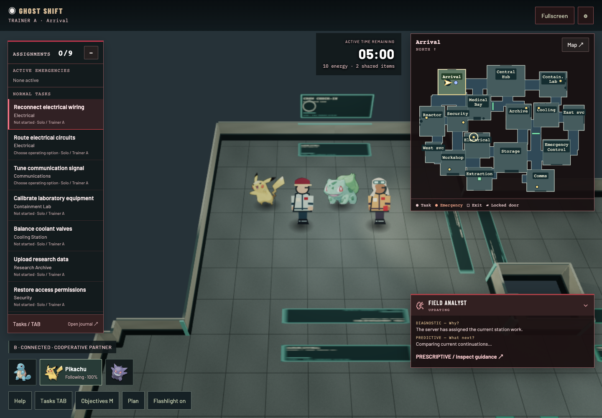
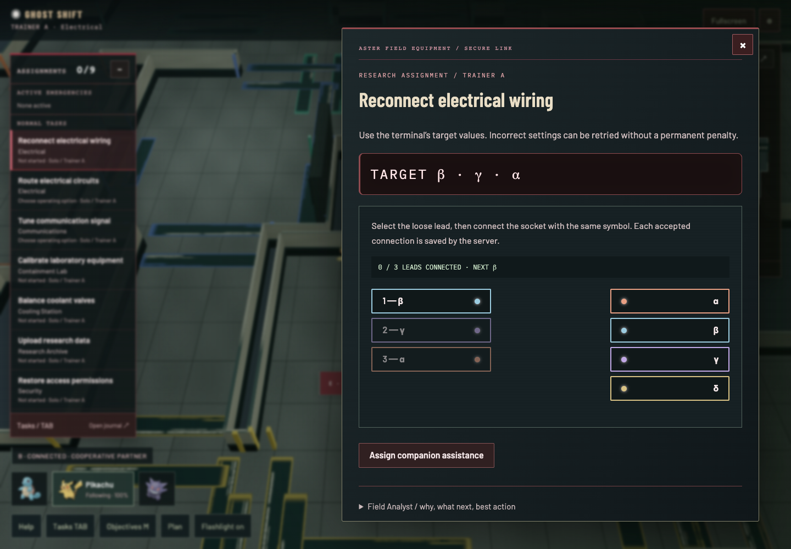
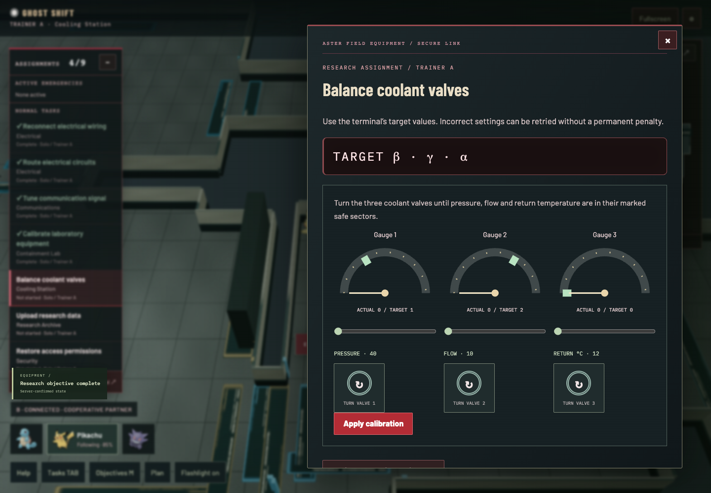
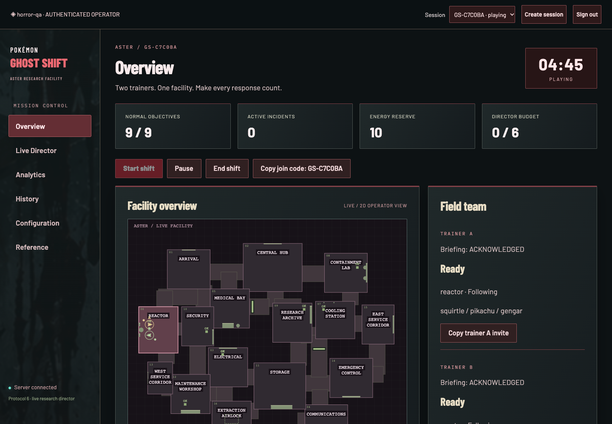
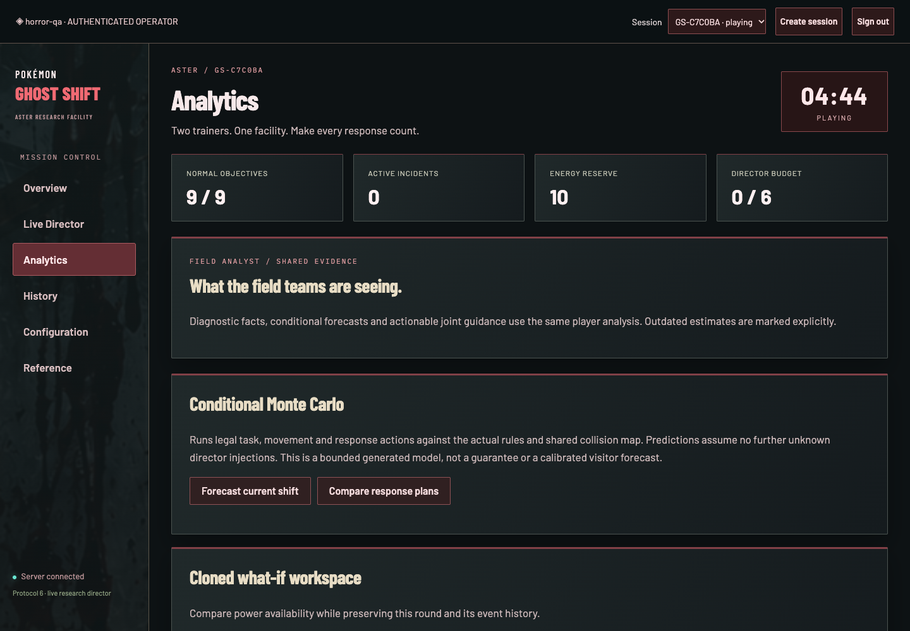
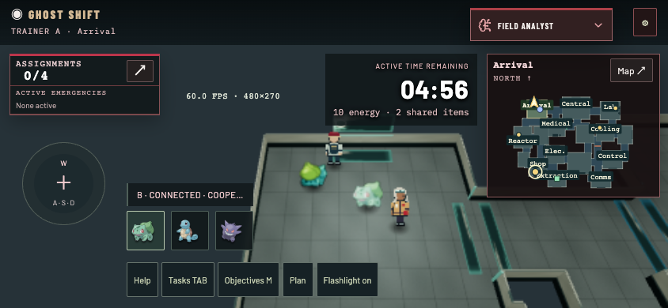
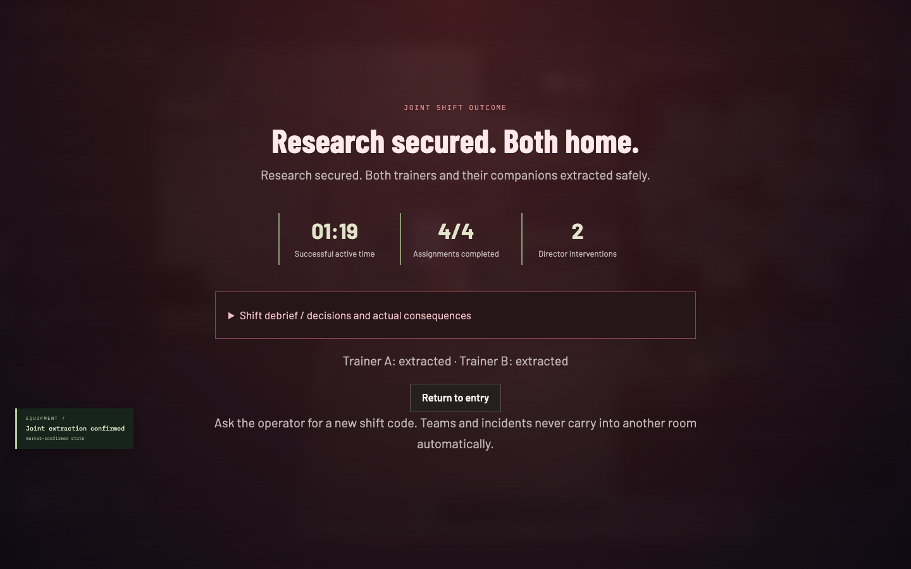

# Ghost Shift — rendered acceptance screens

Captured in Chrome on this Mac. These are real application screens. The full scenario completed with both trainers physically extracted, four assignments completed and two Director interventions; the captured successful round took 79 active seconds. This is automated gameplay evidence, not visitor pacing data.

## Player title scene

## Third-person trainers and companions

## Task mechanisms

## Operator

## Touch layout and extraction

Detailed QA, asset/font sources, animation coverage and remaining physical-device checks: [QA report](../docs/OVERHAUL-QA.md), [asset sources](../docs/HORROR-ASSETS.md), [controls and rules](../docs/THIRD-PERSON-REVISION.md).
